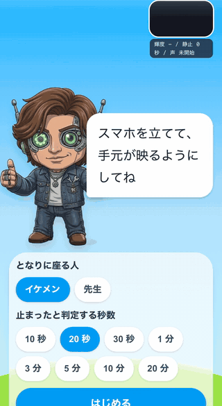

# となり（Tonari）

机の横で手元を見て、詰まったときだけ声をかける、答えを言わない AI 家庭教師。

iPhone の画面を録画したもの（1.5 倍速、音なし）。はじめる → 紙の問題文を読み取る → ヒント 2 回 → 「できた」で正解 → おわる → 今日の記録。

製品説明動画（YouTube）は準備中。

## 製品概要

### 背景（製品開発のきっかけ、課題等）

今の時代、分からない問題を AI に聞く人が増えている。そこには 2 つの問題がある。

- **すぐ答えを言われる。** ChatGPT や写真解答アプリは、聞かれたことに答えるのが仕事で、「自分で解ききる」ことを守ってはくれない。答えを見た問題は、テストで解けない。
- **聞くまでの工程が重い。** スマホを開き、ChatGPT などのアプリを開き、写真を撮り、質問を打つ。手が止まり、紙から目が離れる。このコストを省きたい。

となりは、手元を見ていて、詰まったときに向こうから声をかける。スマホには触らない。副次的な効果として、質問のためにスマホを開いて他のアプリに気が移り、勉強しているはずがスマホを触っている、というリスクも減る。

家庭教師や個別指導は、隣で手元を見ていて、止まった瞬間に「どこまでできた？」と聞いてくれる。答えは言わない。これが効くのは分かっているが、高い。保護者も「どこが苦手か」を知りたいが、分かるのはテストの点が出てからだ。

### 製品説明（具体的な製品の説明）

紙の問題（学校の宿題や問題集。初めて見る問題でよい）を解いている手元を、スタンドに立てたスマホが見ています。

1. となりに座る人を選びます（先生かイケメン）。絵、ヒントの口調、声が変わります。「はじめる」を押すと、AI が紙の問題文を読み取り、画面の左上に出します。
2. 手が止まって、本人が選んだ秒数（10 秒〜20 分、既定 20 秒）がたつと、AI が答案を見て「2行目の右辺の 4 を見てみて」のように、見る場所か次の一歩を 1 つだけ声で教えます。答えは言いません。
3. 直したら、答えまでの次の一歩を問いかけます。それでも止まっていると、もう少し具体的に（する操作を 1 つ）言います。
4. 「移項って何？」「この後どうするの」と声で聞けば、言葉の意味ややり方を説明します。独り言や周りの会話には答えません。
5. 解けたら「できた」を押すと、AI が正誤を見て次の問題へ進みます。
6. 「おわる」の後に「今日の記録」を開くと、何問目で・何回・どの段階のヒントを出し・どこで詰まったかが見られます。保護者や運営は `/log` で同じ記録を見られます。映像は残しません。

専用機器は要りません。家にあるスマホと 1,000 円のスタンドで始められます。教材も選びません。

### 特長

#### 1. 聞かれる前に気づく

ブラウザが 1 秒ごとにフレーム差分で手元の動きを数値にし、サーバが「静止が選んだ秒数続いた」を詰まりと判定します。映像は毎秒送りません。写真を送るのは、はじめたとき・手が止まったとき・ボタンや声で呼んだときの 1 枚だけです。詰まりの 3 秒前に先に写真を送り、AI がヒントを作り始めるので、「考え中？」とほぼ同時に声が出ます。

#### 2. 答えを言わないことを、プロンプトでなくサーバで守る

AI には同じ呼び出しで問題を解かせておき、ヒント文にその答えや途中の値が含まれていれば、サーバが捨てて固定の問い返しに差し替えます。「答えを教えて」「x = 3 で合ってる？」と言われても、答えと正誤は言いません。発話の中の「答えを書いて」という指示にも従いません。

#### 3. 映像でなく「詰まりポイント」だけを残す

記録に残るのは、何問目で・何回・どの段階のヒントを出し・詰まりポイント（移項の符号、係数で割る、など 12 種のラベル）は何か、だけです。映像も、聞き取った声の文も保存しません。

### 解決出来ること

- 詰まった瞬間に、答えを見ずに自分で解き直す経験を、家で一人でもできる。
- 保護者が、テストを待たずに「どこで詰まっているか」をラベルで知れる。
- 教材を選ばない。手元の紙の問題をそのまま使える。

### 今後の展望

- **難しい問題でも、示す場所を外さない。** 今は中学の一次方程式が中心で、連立方程式や文章題、図形のように解き方が分かれる問題では、AI が最初の誤りや次の一歩を取り違えることがある。問題の種類ごとに評価セットを作り、ヒントの的中率と答え漏れの誤検知率を測りながら指示を育てる（[#64](https://github.com/jphacks/os_2601/issues/64)）。
- **となりに座る人を増やす。** 今は先生とイケメンの 2 人。人格の中身は口調の言い回しと固定文と声の 1 か所（`api/app/personas.py`）に集めてあるので、絵・口調・声の組を足すだけで増やせる。学習者が「今日はこの人と」と選ぶ楽しさを、続ける理由にする。
- **コストを切り詰め、採算を確かめる。** 収益性はまだ確かめていない。AI の呼び出しは問題ごとに数回、音声の合成は 1 文ごとなので、1 セッションあたりの原価を測り、先読みの回数や写真の大きさ、音声の作り置きで削る。家庭が払える月額に収まるかを先に見極める。
- **より人に近い声に。** VOICEVOX は端末の音声合成より自然になったが、抑揚と間はまだ機械的。声の候補を聞き比べ、ヒントの文の長さや句読点を声に合わせて調整する。
- **声が出るまでの間をなくす。** ヒントは詰まりの 3 秒前に先読みして待ち 0 秒にしたが、音声の合成に 1〜2 秒、声の問いへの答えには AI の応答がそのまま乗る。音声を文の途中から流す、短い相づちを先に返す、答えも先読みする、で「隣にいる人」の間に近づける。

### 注力したこと（こだわり等）

- **静止の判定**：手を止めたときのスコアと書いているときのスコアを本番の iPhone で測り、画素ごとの差の中央値で明るさの変化を除き、静止に入る境目（0.03）と抜ける境目（0.045）を分けた。
- **先読み**：詰まりの 3 秒前に写真を送って AI のヒントを作っておき、詰まった瞬間に待ち時間 0 で声が出る。
- **答え漏れの検査**：AI に解かせた答え・途中の値とヒント文を、記号の読み（イコール、マイナス、エックス）も戻してから照合する。学習者が紙にすでに書いた値は守らず、1 桁の答えは「答えは5」のような言い回しで止める。
- **声の問いへの答え**：聞こえた文はすべて AI に送り、答えるかどうかも AI が決める。AI を待つ間はボタンを止めない。
- **人格は口調だけ**：ヒントの中身（示す場所と操作）は人格で変えず、AI への指示の言い回しの 1 行だけを差し替える。テンプレートで文を組む案は、本物の AI で比べてヒントがぼやけたので捨てた（ADR 0031）。
- **設計の記録**：決めたことは ADR（35 本）に、比べた案と受け入れたトレードオフごと残した。直す前に文書を直す。

## 開発技術

### 活用した技術

#### API・データ

- Google Gemini API（`gemini-3.5-flash-lite`）：答案の写真からの問題文の読み取り、ヒントの生成、正誤の判定。構造化出力（`responseSchema`）で答え・途中の値・ヒントを分けて受け取る
- VOICEVOX：読み上げの声。Railway に立てたエンジンを API 経由で呼ぶ。イケメンは VOICEVOX:青山龍星、先生は VOICEVOX:冥鳴ひまり
- Web Speech API：音声認識（声の問いの聞き取り）と、VOICEVOX が使えないときの読み上げ
- MediaDevices（`getUserMedia`）：手元の映像。64×36 に縮小して差分を取り、毎秒捨てる

#### フレームワーク・ライブラリ・モジュール

- フロント：Next.js 16（App Router）、React 19、TypeScript、Tailwind CSS。Vercel
- API：FastAPI（Python 3.12）、httpx、Pydantic。Railway
- 契約：OpenAPI（`openapi.yaml`）を正とし、モックで画面を先に作った

#### デバイス

- iPhone（Safari）をスタンドに立てて手元を撮る。デモでは Mac の Chrome と連係カメラ
- 聞き取りは端末のブラウザ。読み上げは VOICEVOX の音声を端末で鳴らす

### 独自技術

#### ハッカソンで開発した独自機能・技術

- 静止の判定と状態機械：[`web/lib/motion.ts`](web/lib/motion.ts)、[`api/app/state.py`](api/app/state.py)。[0ea77b6](https://github.com/jphacks/os_2601/commit/0ea77b6)（明るさの補正と抜ける境目）、[def378d](https://github.com/jphacks/os_2601/commit/def378d)
- 詰まりの 3 秒前の先読み：[`api/app/routes.py`](api/app/routes.py)、[`web/lib/loop.ts`](web/lib/loop.ts)。[44b8abb](https://github.com/jphacks/os_2601/commit/44b8abb)
- 答え漏れの検査と読み上げの正規化：[`api/app/leak.py`](api/app/leak.py)、[`api/app/reading.py`](api/app/reading.py)、[`api/app/hints.py`](api/app/hints.py)。[f4ad5d3](https://github.com/jphacks/os_2601/commit/f4ad5d3)（初見の問題に 1 回目から AI のヒント）、[26d1eae](https://github.com/jphacks/os_2601/commit/26d1eae)（最初の誤りか次の一歩を示す）、[d0a5333](https://github.com/jphacks/os_2601/commit/d0a5333)（精度の穴 6 つ）
- 声の問いへの答え：[`api/app/hints.py`](api/app/hints.py) の `compose_answer`、[`web/lib/voice.ts`](web/lib/voice.ts)。[acc5d6b](https://github.com/jphacks/os_2601/commit/acc5d6b)
- 問題文の読み取り（はじめた 3 秒後）：[41c9436](https://github.com/jphacks/os_2601/commit/41c9436)
- 記録画面と「今日の記録」：[`web/app/_components/record/`](web/app/_components/record/)。[9d1133b](https://github.com/jphacks/os_2601/commit/9d1133b)、[9cf4048](https://github.com/jphacks/os_2601/commit/9cf4048)
- 人格（先生・イケメン）：[`api/app/personas.py`](api/app/personas.py)。[776c8d3](https://github.com/jphacks/os_2601/commit/776c8d3)
- VOICEVOX の声：[`api/app/voicevox.py`](api/app/voicevox.py)、[`web/lib/speech.ts`](web/lib/speech.ts)。[4b9cf30](https://github.com/jphacks/os_2601/commit/4b9cf30)
- 設計の記録：[`docs/adr/`](docs/adr/README.md)。残っている課題は [Issues](https://github.com/jphacks/os_2601/issues)

## 何を撮り、何を送り、何を残すか

| 段階 | 何が | どこへ | 残るか |
|---|---|---|---|
| 毎秒 | 映像 | ブラウザの中。64×36 に縮小して差分を取り、捨てる | 残らない |
| 毎秒 | 動きスコア（数値 1 つ） | サーバ | 状態の遷移だけ |
| はじめたとき・手が止まったとき・ボタンや声で呼んだとき | 写真 1 枚 | サーバ → Gemini API | サーバには残らない |
| ヒント時 | 詰まりポイントのラベル、段階、文、きっかけ | サーバの記録 | 残る（記録画面の主役） |
| 見守り中 | マイクの音声 | ブラウザの音声認識で文にし、写真 1 枚と一緒に Gemini API へ | 音声も文も残らない。答えたときだけ「声で呼んだ」記録 |

## 既知の制約

- 詰まりの判定は「手元の動きが選んだ秒数（10 秒〜20 分、既定 20 秒）ない」というヒューリスティックです。考えているだけでも声がかかります。最初の声を問い返しにし、ヒントの後は黙る設計（秒数は設定）で緩和していますが、解決の証明ではありません。
- 「答えを言わない」は、AI に同じ呼び出しで問題を解かせ、その答えの文字列とヒント文をサーバが照合して守っています。AI が解き間違えると、この検査も外れます。「2 倍して 10 になる数」のような言い換えは止められません。
- 問題は学習者の紙の問題（初見）で、AI が写真から読んで解きます。読み違い・解き間違いがあり、そのときはヒントや正誤も外れます。
- 手書きの読み取りは生成 AI（Gemini）の画像理解に依存し、照明や筆圧で失敗します。失敗時は理由ごとの固定文（「もう少し明るいところで見せてみて」など）に落とします。
- 映像は手元だけで、保存しません。ただし、はじめたとき、手が止まったとき、「ヒント」「できた」を押したとき、声で問いかけたときの 1 枚は Google の Gemini API に送られます。Hack Day 版は無料枠を使っているので、送った 1 枚は Google のサービス改善に使われることがあります。製品では学習に使われない有料枠にします。
- 席を立ったことは検知しません。手が止まれば問い返しの声がかかります。
- 声の聞き取りはブラウザの音声認識で、音声は Chrome なら Google、Safari なら Apple のサーバで文字にされます。聞き取った文は、そのときの写真 1 枚と一緒に Gemini API に送り、答えるかどうかも AI が決めます。文は保存せず、答えたときだけ「声で呼んだ」記録が残ります。
- 読み上げは VOICEVOX の声で、1 文作るのに 1〜2 秒かかります。作れないときはブラウザの音声合成に戻り、端末によって声が違います。
- scripted モードは AI を使わず固定の問い返しを再生します。使ったときはピッチで言います。

## 既存の取り組みとの位置づけ

Photomath や ChatGPT のカメラは「聞かれて答える」。Khanmigo は「答えを言わないが、聞かれるのを待つ」。となりは「聞かれる前に気づいて、答えを言わない」。そして紙を見ています。

| | Photomath / Qanda | ChatGPT・Gemini のカメラ／音声 | Khanmigo（Khan Academy） | タブレット型 AI 教材 | 家庭教師・個別指導 | となり |
|---|---|---|---|---|---|---|
| きっかけ | 学習者が写真を撮る | 学習者が話しかける | 学習者が打つ | 画面の中で出題 | 先生が気づく | **手が止まって 20 秒で気づく** |
| 答え | 解法と答えを出す | 聞けば出す | 言わない設計（ソクラテス式） | 解説を出す | 言わない | **言わない。サーバで機械的に検査** |
| 見ているもの | 写真 1 枚 | 映像（会話中） | テキスト | 画面内の操作 | 手元・表情 | **紙の手元（動きと、要るときの 1 枚）** |
| 紙の宿題 | 撮れば使える | 映せば使える | 使えない（打ち直す） | 使えない | 使える | **使える（初見の問題でよい）** |
| 保護者への記録 | なし | なし | 一部（学習ログ） | あり（画面内の正誤） | 口頭 | **詰まりポイントのラベル** |
| 値段 | 無料〜月額 | 月額 | 月額 | 月額 | 月数万円 | スマホとスタンド |

各製品の仕様は Web で読んだ範囲の理解で、細部は変わりうる（2026-10-03 時点）。

## 動かし方

- API：`uv run --directory api --env-file .env uvicorn app.main:app --reload --port 8000`。`.env` に `GEMINI_API_KEY`・`OPERATOR_KEY`（任意で `VOICEVOX_URL`。無ければブラウザの声）
- 画面：root で `pnpm dev:mock`（モック。API 不要）か `pnpm dev`（本物の API。`web/.env.local` に `NEXT_PUBLIC_API_BASE`）
- 検査：`pnpm check`（型・lint・ビルド）、`uvx ruff check api`、`uv run --directory api pytest`（158 件）。CI でも同じものを回す
- セッションの作成：`uv run --directory api --env-file .env tools/create_session.py --worksheet FREE --mode live --stuck 20 --count 1`（`.env` に `API_BASE`・`WEB_BASE` も要る）。出た `/device?s=…&t=…` を手元を撮るスマホで開く。`/ops` からも作れる

## 文書

- 仕様：[`docs/`](docs/00_README.md)（00〜12）
- 設計の決定：[`docs/adr/`](docs/adr/README.md)
- API の契約：[`openapi.yaml`](openapi.yaml)
