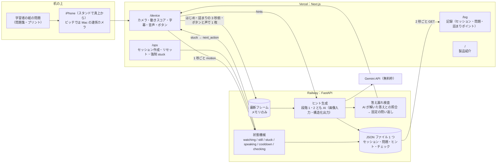
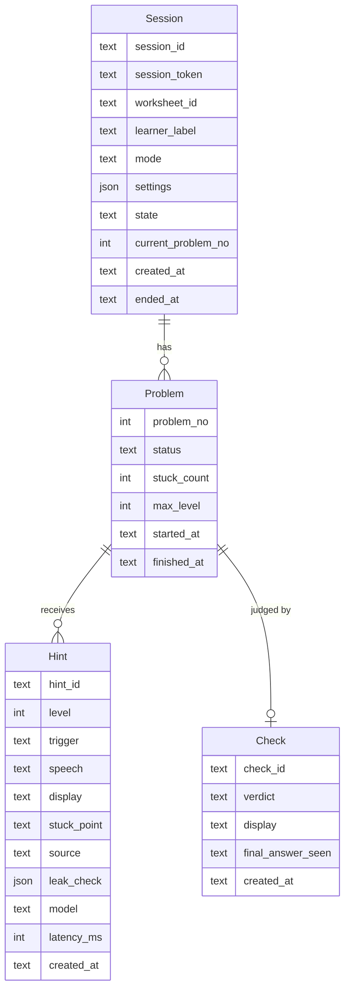
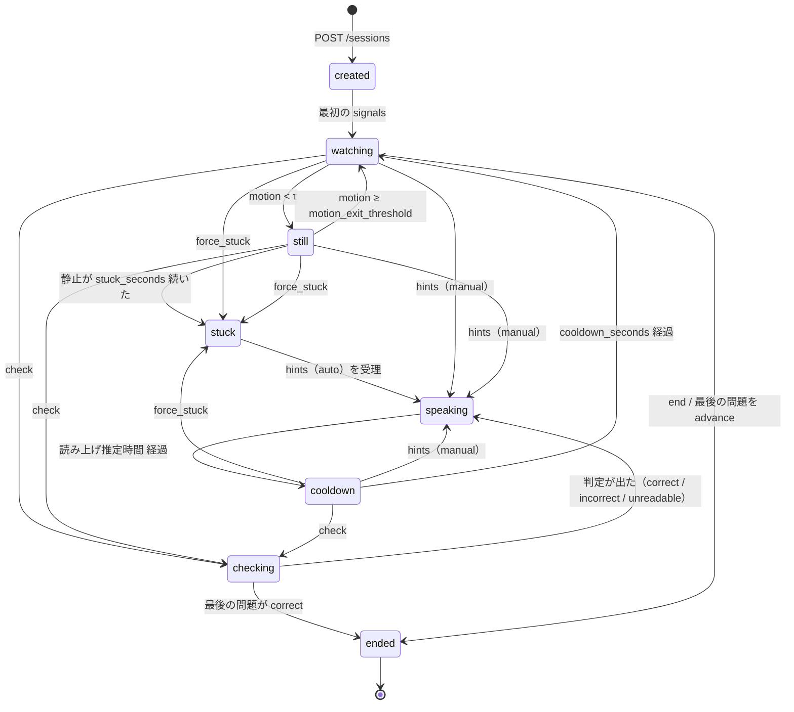
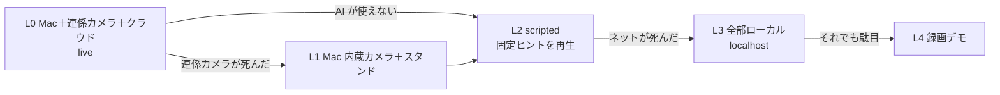

# 02 アーキテクチャ（Hack Day 版）

10/16 に Hack Day で作る範囲に縮めた。SQLite・Volume・SSE・サムネイル・`quiet`・`away`・H3/H4 は Kaizen Sprint の候補で、この文書には書かない。

## 全体構成と信頼境界



### 信頼する範囲と、外に出るもの

| 何が | どこまで行くか | 残るか |
|---|---|---|
| 映像（毎秒） | ブラウザの中だけ。動きスコアの計算に使って捨てる | 残らない |
| フレーム（JPEG、長辺 1024） | 「はじめる」の 3 秒後（問題文の読み取り、ADR 0034）・手が止まって 17 秒（詰まりの 3 秒前）・「ヒント」「できた」の瞬間の 1 枚だけサーバへ。サーバはメモリに最新 1 枚だけ持つ | 残らない |
| 詰まった瞬間・「できた」の瞬間のフレーム | ヒント生成・正誤チェックのために Gemini API（無料枠）へ送る | API 側の扱いは Google の規約に従い、無料枠では Google のサービス改善に使われうる（ADR 0025）。ピッチで自分から言う |
| 状態、ヒント文、詰まりポイント、正誤 | JSON ファイル | 残る。記録画面に出すのはこれ |
| AI が解いた答えと途中の値（`leak_strings`） | サーバだけ | デバイス・記録画面には出ない |
| 音声（マイク） | ブラウザの音声認識（Chrome は Google、Safari は Apple のサーバ）で文字にし、聞き取った文を写真 1 枚と一緒に AI に送る。答えるかは AI が決める（ADR 0032） | 音声は残らない。聞き取った文字も保存しない（答えたときだけ `trigger: voice` が残る） |

ピッチでは「映像は手元だけ、残るのはラベルだけ。ただし手が止まったときの 1 枚は AI に送る」と自分から言う。

## 認可の 3 系統

| 系統 | ヘッダ | 使えるもの | 持つ人 |
|---|---|---|---|
| デバイス | `Authorization: Bearer <session_token>`（セッション作成時に発行） | `POST /sessions/{id}/signals` `frames` `hints` `check` `advance` `end`、`PATCH /sessions/{id}/settings`、`GET /sessions/{id}` | その机のブラウザだけ |
| オペレータ | `X-Operator-Key`（環境変数 `OPERATOR_KEY`） | `POST /sessions` `GET /sessions*` `POST /sessions/{id}/end` `POST /demo/reset`、`POST /sessions/{id}/signals` は `force_stuck: true` のときだけ | `/ops`・`/log` を操作する人 |
| 公開 | なし | `POST /sessions/open`（IP ごとに 1 分 10 件・全体で 1 分 30 件、30 分で自動終了、2 時間で消える。ADR 0036・0039）、`GET /healthz` | 誰でも |

正答はどの系統からも API では返さない。セキュリティの境界はトークンであり CORS ではない。

## コンポーネントと責務

| コンポーネント | 場所 | 担当 | 責務 |
|---|---|---|---|
| `web/lib/**` | Vercel | 高橋 | カメラ取得（`camera.ts`）、動きスコア（`motion.ts`）、音声合成（`speech.ts`）、音声認識（`voice.ts`）、API クライアント（`api.ts`）、**1 秒ごとの送信・自動ヒント・声のトリガーのループ（`loop.ts`）**。映像を `canvas` から取り出すのと、音声を扱うのはここだけ |
| `/device` | Vercel | B | 映像枠、状態バッジ、字幕、ボタン。`web/lib` の関数を呼んで表示するだけ |
| `/ops` | Vercel | B | セッション作成（`/device` の URL を表示）、リセット、強制 stuck、セッション一覧 |
| `/log` | Vercel | C | セッション一覧と問題ごとの経過。2 秒ごとに `GET` |
| `/` | Vercel | D | 製品紹介と 3 画面への入口 |
| `api/` | Railway | 高橋 | セッション、状態機械、フレーム保持、ヒント生成、答え漏れ検査、正誤チェック、固定の問い返し、JSON 保存 |

## リポジトリ構成（当日作る）

```
os_2601/
├── api/
│   ├── app/
│   │   ├── main.py        # FastAPI、CORS、ルート登録、起動時に設定と保存の読込
│   │   ├── routes.py      # 全エンドポイントと、状態機械を当てて保存する処理（分け方は ADR 0041）
│   │   ├── errors.py      # HTTP のエラーを投げる fail()
│   │   ├── context.py     # AppContext（設定・保存・写真・先読み・回数をまとめたもの）
│   │   ├── schemas.py     # 要求の型（pydantic）
│   │   ├── auth.py        # トークンと運営の鍵の確認
│   │   ├── limits.py      # 作成の口・AI・声の回数の上限、同時に 1 本（ADR 0036・0039）
│   │   ├── composer.py    # 問題の記録と最新の写真から AI のヒントを作る入口
│   │   ├── prefetch.py    # 詰まりの 3 秒前の先読み（ADR 0028）
│   │   ├── views.py       # 応答の形（セッションの作成・一覧・詳細、ヒント、問題の記録、詰まりの集計）
│   │   ├── timing.py      # かかった時間（ミリ秒）をログと記録に出す elapsed_ms()
│   │   ├── state.py       # 状態機械（純粋関数 step()＋表駆動テスト）
│   │   ├── store.py       # JSON ファイル 1 つに保存・読込
│   │   ├── hints.py       # AI のヒント・声の答え・問題文の読み取り、答え漏れで差し替え、固定の問い返し、scripted
│   │   ├── prompts.py     # AI への指示文と構造化出力の型（ヒント・声の答え・問題文の読み取り。紙が写っているかを先に聞く指示も。ADR 0044）
│   │   ├── utterances.py  # 聞こえた文が「合ってる？」か助けを求める文かの判定
│   │   ├── check.py       # 正誤チェック
│   │   ├── gemini.py      # Gemini API の呼び出し（タイムアウト 8 秒、リトライなし）
│   │   ├── leak.py        # 答え漏れ検査（正規化と照合）
│   │   ├── reading.py     # 読み上げの文の記号を言葉に（= → イコール）
│   │   ├── numerals.py    # 漢数字を算用数字に（leak.py と reading.py が使う）
│   │   ├── personas.py    # 人格（先生・イケメン）の口調と固定文
│   │   └── voicevox.py    # VOICEVOX の声（ADR 0035）
│   ├── tools/             # create_session.py、eval_leak.py（答え漏れの評価セット）、check_*.py（本物の AI での確認）
│   ├── tests/             # pytest
│   ├── settings.yaml      # しきい値（stuck_seconds など）
│   ├── Dockerfile
│   └── pyproject.toml     # uv
├── web/
│   ├── app/
│   │   ├── page.tsx       # D
│   │   ├── device/        # B
│   │   ├── ops/           # B
│   │   └── log/           # C
│   ├── lib/               # 高橋（camera.ts motion.ts speech.ts voice.ts api.ts loop.ts）
│   ├── mocks/             # 状態別フィクスチャ（03 の表）
│   └── package.json       # dev / dev:mock / check / test
├── docs/                  # この文書一式 + pitch/ + video/
├── .github/               # workflows/check.yml、pull_request_template.md
├── .githooks/             # guard.mjs、pre-commit、pre-push（ハーネスと依存のファイル・main への push・force push を止める。ADR 0030）
├── .claude/               # settings.json（同じ guard を編集前に走らせる）、commands/
├── docs/prompts/          # start / check / pr / sync（Codex は貼る、Claude Code はスラッシュコマンド）
├── AGENTS.md              # AI が最初に読む決まり（CLAUDE.md と同じ中身）
├── team.json              # GitHub ログイン → 役割（CI の担当検査）
├── .role.local            # 各自の役割 1 語（git に入れない）
├── package.json           # ルート。web と api の検査をまとめる（pnpm check）
├── openapi.yaml           # 契約（高橋）
├── CLAUDE.md              # AGENTS.md と同じ
├── RUNBOOK.md
└── README.md              # JPHACKS 書式（C）
```

- **pnpm ワークスペース**（root に `pnpm-workspace.yaml`、ロックファイルは root の 1 本）。ルートの `package.json` は `web` への委譲だけ（`"dev:mock": "pnpm --filter web dev:mock"`、`"check": "pnpm --filter web check"`）。B・C・D はリポジトリの root で `pnpm dev:mock` / `pnpm check` だけ打つ。PowerShell 5.1 でも `pnpm` のスクリプト内の `&&` は動く（`sh` でなく pnpm が解釈する）。
- `api/tools/*.py` は `uv run --directory api` で動く。
- Railway のサービスはルートディレクトリを repo の root にし、`RAILWAY_DOCKERFILE_PATH=api/Dockerfile`。Dockerfile は `COPY api/ /app/api/` で api だけを入れる。

## データ

JSON ファイル 1 つ（`DATA_PATH`、既定 `./data/tonari.json`。親ディレクトリは作る）に `{"sessions": {id: Session}}` を持つ。起動時に読み（`ended` 以外は `watching` に戻す）、セッション作成・設定変更・ヒント・チェック・進行・終了のときだけ tmp に書いて rename する。書き出すときに JSON に直すのは前回から `put()` したセッションだけで、残りは前回の文字列を使う（取り出して書き換えたら `put()` してから `save()`）。読めないファイルは `tonari.<UTC 時刻>.broken` に退けて空で起動する。終わったセッションは時刻を進めても変わらないので、複製も保存もしない。全ルートは `async def`、uvicorn は 1 ワーカーなのでロックは要らない。`signals` は書かない（状態と `still_since` はメモリ）。再デプロイで消えてよい（ピッチ前に `/demo/reset` する）。



`final_answer_seen` は AI が読み取った最終答案（デバッグ用）。API では返さない。最新フレーム（長辺 1024 の JPEG）はプロセスのメモリに `session_id → bytes` で 1 枚だけ持つ。

## 状態遷移



- 状態はサーバが持つ。デバイスは 1 秒ごとの `signals` の応答で状態を受け取り、表示を変える。
- `still` の継続秒数はサーバが数える。デバイスの時計には頼らない。
- 自動のヒントは `stuck` からだけ出る。`cooldown` の間は静止が続いても自動では出ない（手動は出る）。
- `stuck`・`speaking`・`checking` の間は `motion` を無視する。詳細な規則は 04 の表。
- 同じ問題で `stuck` になるたびに `stuck_count` が増え、自動ヒントの段階は `min(stuck_count, max_level)`（既定 2）。次の問題に進むと 0 に戻る。
- `ended` からは出ない。`signals` には `{"state": "ended"}` を返す。

## 生成 AI の呼び出し

- `hints.py`（ヒント・声の答え・問題文の読み取り）と `check.py`（正誤）の 2 箇所。モデルは `HINT_MODEL`・`CHECK_MODEL`（既定はどちらも `gemini-3.5-flash-lite`）。`api/app/gemini.py` が REST で `responseSchema` の構造化出力を受け取る。タイムアウト **8 秒**、リトライなし（ADR 0025）。
- ヒント：駄目なら固定の問い返し（`source: "fallback"`）。正誤：AI は判定だけ、読み上げ文は固定。駄目なら `unreadable`。
- 画像は長辺 1024 の JPEG を base64 の `inline_data` で渡す。1 回の呼び出しで 1 枚。
- 遅延の目標は「詰まり判定からヒントの読み上げ開始まで 4 秒以内」。詰まりの 3 秒前に写真を送ってヒントを先に作る（ADR 0028）。
- 回数の上限はセッションごとに 1 分 20 回（ADR 0039）。

## 環境変数

| 変数 | 置き場所 | 用途 |
|---|---|---|
| `GEMINI_API_KEY` | Railway | 生成 AI（Gemini）の呼び出し。10/17 に `OPENAI_API_KEY` から変更（ADR 0025） |
| `VOICEVOX_URL` | Railway | VOICEVOX のエンジン（内部の通信、`http://voicevox.railway.internal:50021`）。無ければブラウザの声（ADR 0035） |
| `OPEN_SESSIONS` | Railway | `0` で `/sessions/open` を閉じる。既定は開く（ADR 0036） |
| `HINT_MODEL` / `CHECK_MODEL` | Railway | 既定 `gemini-3.5-flash-lite` / `gemini-3.5-flash-lite`。ヒントが遅ければ `HINT_MODEL` も `gemini-3.5-flash-lite` |
| `OPERATOR_KEY` | Railway・オペレータの手元 | オペレータ系統の認可。Hack Day 後に変える |
| `CORS_ORIGINS` | Railway | カンマ区切りの正規オリジン（`http://localhost:3000`、Vercel の本番 URL） |
| `CORS_ORIGIN_REGEX` | Railway | 既定 `https://.*\.vercel\.app\|https://.*\.trycloudflare\.com`（`\|` は正規表現の「または」。B・C のプレビュー用）。許可ヘッダに `Authorization` と `X-Operator-Key` |
| `DATA_PATH` | Railway | JSON ファイルの置き場（既定 `./data/tonari.json`） |
| `DEMO_MODE` | Railway | `1` のときだけ `/demo/reset` を有効化（Hack Day 中は `1`） |
| `WEB_BASE` / `API_BASE` | 高橋の手元（`api/.env`） | `create_session.py` が `/device?s=&t=` と `/log/<id>?k=` の URL を組む |
| `PORT` | Railway が注入 | `uvicorn --port $PORT` |
| `NEXT_PUBLIC_API_BASE` | Vercel | バックエンドの URL |
| `NEXT_PUBLIC_MOCK` | Vercel（開発時） | `1` でモックデータのみで動く |

## ホスト名と HTTPS

- カメラ（`getUserMedia`）と音声合成は、`localhost` を除き HTTPS でしか動かない。Vercel の URL か `localhost` で開く。スマホから PC の開発サーバを `http://<PCのIP>:3000` で開くとカメラは取れない。
- B・C が自分の画面をスマホで見るときは `cloudflared tunnel --url http://localhost:3000`（HTTPS の一時 URL。`CORS_ORIGIN_REGEX` で許してある）。

## デプロイ

| 対象 | 方法 | 注意 |
|---|---|---|
| バックエンド | Railway、`api/Dockerfile`（ビルド文脈は root）、Volume なし | App Sleeping を無効にする。再デプロイで JSON ファイルとメモリのフレームが消える（消えてよい） |
| フロント | Vercel、`main` ブランチの自動デプロイ（Root Directory は `web`） | プレビューは確認用のみ。org の GitHub 連携が入らなければ Mac から `vercel` CLI |
| 凍結 | Day 2 12:30（動画用 `v-video`）〜撮影終了、14:30 以降 | 撮影中とピッチ前はデプロイしない |

Day 1 の 10:20〜11:00 に、空のアプリを両方デプロイして疎通（CORS・カメラ）を確かめる。

## 退避の階段



- L1 は `?cam=` を外して Mac 内蔵カメラを使う。スタンドで Mac を置けないなら、iPhone 単体で `/device` を開く（音は iPhone から）。
- L2 はオペレータが `/ops` で `mode: scripted` のセッションを作り直す。デバイスの操作は同じ。ピッチで「固定ヒントを再生しています」と言う。
- L3 は `uv run uvicorn` と `pnpm dev` を Mac で立ち上げ、`localhost` で開く。手順は `RUNBOOK.md`。
- L4 の録画は Day 2 の 12:30〜14:00 に撮る。README にも必要。
