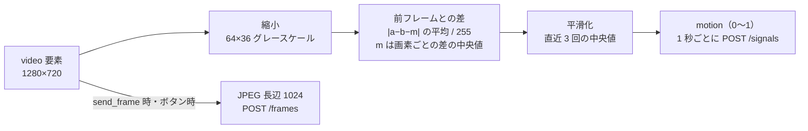
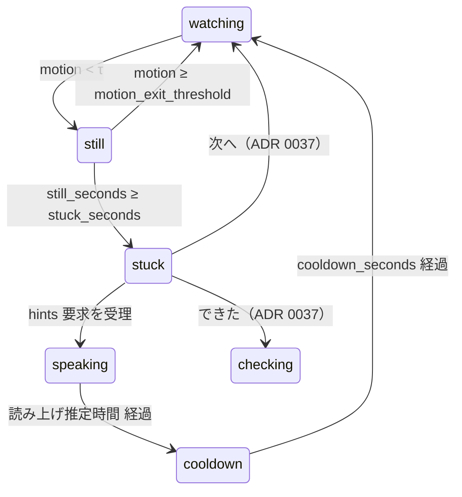

# 04 詰まりの検知

## 原則

- 映像は毎秒ブラウザの中で処理し、動きの大きさ（数値）だけをサーバに送る。映像そのものは、手が止まって `stuck_seconds − 3` 秒（既定 17 秒）たったときと、ボタンを押したときの 1 枚しか送らない（ADR 0028）。
- 「詰まった」の判定はサーバの状態機械が行う。判定 `step(session, event, now, settings) -> (session, actions)` は副作用のない関数にし、表駆動のテストを書く（`api/tests/test_state.py`）。しきい値は `settings.yaml` に置く。
- 検知しているのは「手元の動きがない」ことだけ。考えているのか、詰まっているのか、ぼんやりしているのかは区別しない。だから最初の声は問い返し（H1）にし、間違って声をかけても害が小さいようにする。
- 手の検出モデルは使わない。フレーム差分だけ。理由は、2 日で確実に動くこと、スマホの CPU で 1 秒 1 回なら十分なこと、の 2 つ。不在（`away`）の判定は Hack Day 版では作らない。

## ブラウザ側：動きスコア



### 計算手順（`web/lib/motion.ts`、高橋が書く）

1. `requestVideoFrameCallback` か `setInterval(1000)` で 1 秒に 1 回、`video` を `canvas` に 64×36 で描く（`drawImage` の縮小で足りる。アスペクト比は 16:9 前提。縦持ちなら 36×64）。
2. `getImageData` でピクセルを取り、グレースケール（`0.299R + 0.587G + 0.114B`）の `Uint8Array` にする。
3. 前回の配列との差の絶対値を全ピクセルで平均し、255 で割って 0〜1 にする。これが生の差分。10/17 から、画素ごとの差 `a−b` の中央値 `m` を求め、`|a−b−m|` を平均する。自動露出やちらつきで全体が明るく・暗くなる分を除き、手や影のように画面の一部だけが変わった分はそのまま数える（ADR 0027）。
4. 直近 3 回の生の差分の中央値を `motion` とする（1 フレームの自動露出の揺れを消す）。
5. 最初の 3 秒（3 回）は `motion` を送らず、`camera_ok: true` だけ送る（ウォームアップ）。
6. `video.readyState < 2` やカメラが止まっていれば `camera_ok: false` を送る。サーバはこのとき `still_seconds` を増やさない。

### しきい値の目安（10/16 夜の T0-2 で実機で測って `settings.yaml` に書く）

| 状況 | 生の差分の目安 | 扱い |
|---|---|---|
| 机の上に何もなく、カメラ固定 | 0.002〜0.006 | 静止 |
| ペンを持った手が紙の上で止まっている（呼吸・微動） | 0.005〜0.015 | 静止として扱いたい。τ はこれより上 |
| 書いている | 0.03〜0.10 | 動き |
| ページをめくる、手を大きく動かす | 0.10 以上 | 動き |
| 自動露出が変わった瞬間 | 0.02 前後が 1 回 | 中央値で消える |

- `τ`（`motion_threshold`）の初期値は **0.02**。10/16 夜（T0-2）と Day 1 の計測で、「手が止まっている」の最大値と「書いている」の最小値の間に置く。**10/17 15:07 の本番 iPhone の計測で 0.03 に変更**：止めた手は最大 0.0197、静止を途切れさせた小さな動きは 0.021〜0.029、書いているときは 0.025〜0.083。19:10 に会場の照明で測り直す（Railway のログの `signal … motion=`）。
- 照明が暗いとノイズで差分が上がる。卓上ライトを持ち物に入れる（10 参照）。デバイス画面に「明るさが足りません」を出す条件は、フレームの平均輝度が 60/255 未満。

## サーバ側：状態機械



### 遷移の規則

| 今の状態 | 入力 | 次の状態 | 付随する動作 |
|---|---|---|---|
| `watching` | `motion < τ` | `still` | `still_since = now` |
| `still` | `motion ≥ motion_exit_threshold`（0.045。10/17 に τ から変更、ADR 0027）、または `camera_ok: false`、または `motion` 省略 | `watching` | `still_seconds = 0` |
| `still` | `now − still_since ≥ stuck_seconds − prefetch_lead_seconds`（3 秒。静止がひと続きの間に 1 回だけ） | `still` のまま | 応答に `next_action: send_frame`。デバイスが送ったフレームで、サーバが次の自動ヒントを裏で作り始める。静止が途切れたら取り消す（10/17 に追加、ADR 0028） |
| `still` | `now − still_since ≥ stuck_seconds` | `stuck` | 応答に `next_action: send_frame_and_request_hint`。`problems.stuck_count += 1` |
| `created` | 最初の `signals` | `watching` | 「はじめる」が押された合図 |
| `stuck` | `POST /hints`（auto） | `speaking` | ヒント生成。`speaking_until = now + est`。`auto` は `stuck` 以外では 409 |
| `stuck` | `motion ≥ τ` | `stuck` のまま | 動きは無視する。`stuck` を抜けるのは `hints` の受理、`check`・`advance`・`end`、`signals` の途絶（AI 呼び出し中に状態が巻き戻る競合をなくす。ADR 0037） |
| `stuck` | `signals`（毎回） | `stuck` のまま | 応答に `next_action` を毎回入れる |
| `watching` `still` `cooldown` | `signals` に `force_stuck: true` | `stuck` | `motion` を無視。`stuck_count += 1`。`stuck` で受けたら何もしない（二重に数えない）。`created` `speaking` `checking` `ended` では 409 |
| `speaking` / `checking` | `motion` の値 | そのまま | 動きは無視する |
| `speaking` | `now ≥ speaking_until` | `cooldown` | `cooldown_until = now + cooldown_seconds` |
| `cooldown` | `now ≥ cooldown_until` | `watching` | |
| `cooldown` | `motion < τ` が続く | `cooldown` のまま | 自動ヒントは出さない |
| `watching` `still` `cooldown` | `POST /hints`（manual / voice） | `speaking` | 段階は「現在の段階」。`created` `stuck` `speaking` `checking` `ended` では 409 |
| `created` `watching` `still` `cooldown` | `PATCH /settings` | そのまま | `stuck_seconds`・`cooldown_seconds` を差し替える。次の評価から効く |
| `watching` `still` `cooldown` `stuck` | `POST /check` | `checking` | 正誤チェック。判定が出たら `speaking`（最後の問題が `correct` なら `ended`）。`stuck` で受けたら作りかけの自動ヒントは捨てる（ADR 0037） |
| `checking` | 判定が出た | `speaking` | `speaking_until = now + est`。`correct` なら問題を `done` にし `current_problem_no += 1` |
| `watching` `still` `cooldown` `speaking` `stuck` | `POST /advance` | `watching` | 前の問題を `skipped`（`done` なら変えない）。最後なら `ended`。`stuck` で受けたら作りかけの自動ヒントは捨てる。`created` `checking` `ended` では 409 |
| `ended` 以外 | `POST /end` | `ended` | フレームを捨てる |
| `watching` `still` `stuck` | `signals` が 5 秒来ない | `watching` | `still_seconds = 0`。`created`・`speaking`・`checking`・`cooldown` には適用しない |
| `ended` | 何が来ても | `ended` | `signals` には `{"state": "ended"}` を返す |

### 段階の決め方

- 自動ヒントの段階 = `min(problems.stuck_count, max_level)`。1 回目の詰まりは段階 1、2 回目以降は段階 2（どちらも AI が答案を見て作る。ADR 0029。3 回目以降も段階 2 で、前に出した文を渡して別の着眼点を言わせる）。`max_level` の既定は 2。
- 手動（ボタン）と声のヒントの段階 = その問題でボタン・声のヒントが初めてなら 1、2 回目以降は 2（10/17 に変更、ADR 0033。以前は段階を上げなかったが、何度頼んでも具体的にならなかった）。`cooldown` 中でも通る（止めるのは自動だけ）。
- 正誤チェックの `incorrect` は固定文だけで、ヒントは出さない（段階も変えない）。
- 次の問題に進むと段階は H1 に戻る。

### 時刻

- `still_since` などはサーバの時計で記録する。デバイスは時刻を送らない（ADR 0040）。
- `signals` は 1 秒ごとだが、遅れて 2 秒分がまとめて来ることがある。判定は `now` との差で行うので、来た数ではなく経過時間で決まる。
- `speaking_until` と `cooldown_until` の経過もサーバの時計で、次のリクエスト（`signals`・`GET /sessions/{id}`・ボタン系）が来たときに評価する（サーバ側のタイマーは持たない）。評価順は **途絶（5 秒）→ `speaking_until` → `cooldown_until` → 今回の `motion`** の順に 1 回ずつ。
- `still_since`・`speaking_until`・`cooldown_until`・最後に `signals` を受けた時刻はメモリ。起動時に JSON から読み込んだセッションは `ended` 以外を `watching` に戻す（再起動で `speaking` のまま固まらない）。

## 設定（settings.yaml）

```yaml
motion_threshold: 0.03      # τ。T0-2 と Day 1 の計測で更新する（10/17 に 0.02 から変更）
motion_exit_threshold: 0.045  # 静止を抜ける境目。τ 以上でないと起動しない（10/17 に追加、ADR 0027）
warmup_seconds: 3
stuck_seconds: 20           # セッション作成時と /device の選択で上書き可（5〜1200）
cooldown_seconds: 60        # 同上（0〜300）
max_level: 2
signal_timeout_seconds: 5
prefetch_lead_seconds: 3     # stuck の何秒前にフレームを送らせ、ヒントを先に作るか（10/17 に追加、ADR 0028）
frame_interval_seconds: 10
speech_seconds_per_char: 0.15
speech_seconds_base: 1.0
min_brightness: 60
```

## テスト（表駆動）

`api/tests/test_state.py` に次の列を書く。

| ケース | 入力列 | 期待 |
|---|---|---|
| 書き続けている | motion 0.05 を 60 回 | ずっと `watching`、ヒントなし |
| 20 秒止まる | 0.05 ×5、0.01 ×20 | 17 秒目で 1 回だけ `next_action: send_frame`、20 回目で `stuck` と `next_action: send_frame_and_request_hint` |
| 19 秒で動き出す | 0.01 ×19、0.05 | `watching`、ヒントなし |
| 一瞬の揺れ | 0.01 ×10、0.05、0.01 ×15 | 11 回目で `watching`、その後 15 秒では `stuck` にならない（カウントがやり直し） |
| 回線断 | 0.01 ×10、5 秒空く、0.01 ×10 | 空いた時点で `watching`、再開後 10 秒では `stuck` にならない |
| 詰まり中に動く | `stuck` で 0.05 ×3 | `stuck` のまま、`next_action` が 3 回とも付く |
| 強制 stuck | `watching` で `force_stuck: true` | 即 `stuck`、`stuck_count` が 1 増える |
| クールダウン中の静止 | ヒント後、0.01 ×70 | 60 秒は `cooldown`、その後 `still`、さらに 20 秒で `stuck` |
| 手動連打 | `manual` を 5 回 | 段階は上がらない |
| 作成直後 | `created` に `signals` 1 回 | `watching` |
| 終了後 | `ended` に `signals`・`hints`・`check` | `signals` は `ended` のまま 200、他は 409 |

## Kaizen Sprint の候補（今回は作らない）

- 不在（`away`）：ヒント生成時の `learner_present` か MediaPipe Hands で「手がある／ない」を取り、誰もいない机に話しかけない。
- 「静かに」（`quiet`）：ボタンで 5 分黙る。
- 「消しゴムを連打した」を差分の時系列（短い大きな動きが同じ場所で繰り返す）で拾い、詰まりの 2 つ目のサインにする。
- 書いている位置（差分が大きい領域の重心）から「今どの問題を解いているか」を推定し、「次へ」ボタンを不要にする。
