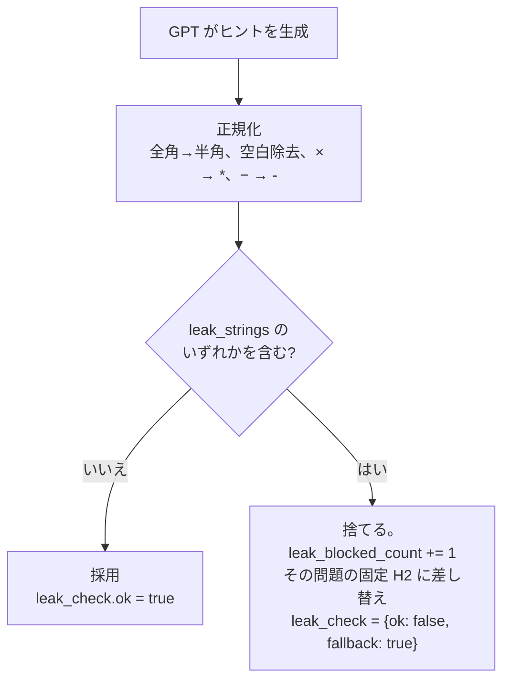

# 05 ヒントの方針と答え漏れ検査

## 原則

- **答えは言わない。** 最終的な答え、途中の決定的な値、式変形の完成形を、どの段階でも口にしない。
- 守り方は 2 層。1 層目はプロンプト（AI への指示）。2 層目はサーバの検査（**同じ呼び出しで AI に解かせた答えと途中の値**とヒント文の照合）。ピッチで主張するのは 2 層目。AI が解き間違えると 2 層目も外れる（10/17 に初見の問題へ変えたため。ADR 0026）。
- ヒントは短い。読み上げは 40 文字以内。家庭教師が隣でぽつりと言う長さ。
- **10/17 に変更（ADR 0026）**：最初の声から AI が答案を見たヒントにする（以前は固定の問い返し）。問い返し「今、何を求めようとしてる？」は、AI が失敗したときと scripted の文として残す。
- 読めないときは読めないなりに成立させる。AI が読めないと言ったら「途中の式を、1 行ずつ声に出して読んでみて」。

## 段階（Hack Day 版は H1・H2 の 2 段階。H3・H4 は Kaizen Sprint）

| 段階 | 名前 | 何を言うか | 例（WS-01 問 2：2x − 7 = 4x + 3） | 答案が読めなくても出せるか |
|---|---|---|---|---|
| H1 | 問い返し | 学習者に状況を言わせる。答案の中身に触れない | 「今、何を求めようとしてる？」「どこまでできた？」 | 出せる |
| H2 | 着眼点 | 見直す場所を 1 つ指す。何が違うかは言わない | 「右辺に移したときの符号、もう一回見てみて」 | 読めないときは一般形「2 行目を声に出して読んでみて」 |
| H3 | 次の一手 | 操作を 1 つだけ言う。結果の値は言わない | 「x の項を左に、数字を右に集めてみて」 | 読めないときは問題文から出せる |
| H4 | 類題の解き方 | 数字を変えた類題の最初の 2 行を言う。元の問題の値は出さない | 「たとえば 3x − 2 = x + 6 なら、3x − x = 6 + 2 にする。同じようにやってみて」 | 出せる（固定ヒントに書いてある） |

- **10/17 以降（ADR 0026）**：段階 1・2 とも AI が答案を見て作る。段階 1 は見直す場所を 1 つ指すか問いかける、段階 2 はもう少し具体的に次に確かめる場所を指す（前に出した文を渡して別の着眼点で）。AI が失敗したときの固定文は、段階 1「今、何を求めようとしてる？」、段階 2「途中の式を、1 行ずつ声に出して読んでみて」。下の表の H1・H2 の例は以前の設計のもの。`max_level` の既定は 2。
- H3・H4 の行は Kaizen Sprint 用に残してある。固定ヒントの `"3"` `"4"` も任意。
- 正誤チェックが `incorrect` のときは H2 相当。「どこが間違いか」は言わず「どこを見直すか」だけ言う。

## 文言の規則

- 読み上げ（`speech`）：40 文字以内。記号（×、÷、²、=）は使わず言葉にする（「かける」「イコール」）。数式は字幕（`display`）に任せる。
- 字幕（`display`）：60 文字以内。数式は半角で、`2x - 7 = 4x + 3` のように読みやすく。
- 命令形でなく提案形（「見てみて」「やってみて」）。名前は呼ばない。「惜しい」「違う」など正誤に触れる語はヒントでは使わない（正誤チェックだけが「正解」「もう一回」を言う）。
- 褒め言葉は正誤チェックの `correct` でだけ。短く具体的に（「符号の直し方、ばっちり」）。
- 「答えは…」「答えは言えないけど」のような前置きは言わない（答えの存在を意識させるだけ）。

## GPT への指示

### 入力

| 項目 | 中身 | 出どころ |
|---|---|---|
| 画像 | 詰まった瞬間のフレーム（長辺 1024 の JPEG、base64） | デバイスの最新フレーム |
| 問題文 | 現在の問題の文（例「2x − 7 = 4x + 3 を解きなさい。」） | ワークシート定義 |
| 段階 | 今回出す段階（Hack Day 版は常に 2） | 状態機械 |
| 典型ミス | この問題でよくある間違いの一覧（例「移項で符号を変え忘れる」「両辺を割るときの符号」） | ワークシート定義 |
| これまでのヒント | この問題で既に出した文 | `hints` テーブル |
| **渡さないもの** | **正答、途中の決定的な値** | 渡さなければ言えない。これが 1 層目の中で最も効く |

正答を GPT に渡さないのは意図的。GPT は答案を読み、典型ミスの一覧と照らして「どこを見直すか」を言うだけでよい。正誤の判定は別の呼び出し（正誤チェック）でだけ正答を使う。

**10/17 以降（ADR 0026）**：ワークシートをやめたので、問題文・正答・典型ミスは渡せない。1 回の呼び出しで、写真から問題文を読ませ（`problem_text`）、自分で解かせ（`final_answer`・途中の値 `key_values`）、詰まりポイントとヒントを出させる。答えと途中の値はサーバの中だけに置き、ヒント文の検査に使う。2 回目からは前に読んだ問題文と前のヒントを渡して、問題と言い回しを揃える。実装は `api/app/hints.py`。

### システムプロンプトの方針

- 役割：中学生の隣に座っている家庭教師。紙のノートの手元の写真を見ている。
- 絶対に守ること：答えの値、途中の決定的な値、式の完成形を言わない。問題を解いて見せない。
- 出すもの：H2（着眼点）のヒントを 1 つ。40 文字以内の読み上げ文と、60 文字以内の字幕文。詰まりポイントのラベル（10 文字以内、典型ミスの一覧から選ぶか、なければ短く作る）。
- 写真の判定：手やペンが写っているか（`learner_present`。記録するだけで動作は変えない）。答案が読めるか（`readable`）。読めなければ H2 の一般形「2 行目を声に出して読んでみて」で出す。
- 段階の定義（上の表をそのまま書く）。
- 文言の規則（上の節をそのまま書く）。

### 構造化出力

```python
from pydantic import BaseModel, Field

class HintOut(BaseModel):
    learner_present: bool = Field(description="手やペンが写っている")
    readable: bool = Field(description="答案の文字が読めた")
    where: str = Field(description="学習者が今どこまで書いているかの短い観察。10〜40 文字。表示しない")
    stuck_point: str = Field(description="詰まりポイントのラベル。10 文字以内")
    speech: str = Field(description="読み上げ文。40 文字以内。記号なし")
    display: str = Field(description="字幕文。60 文字以内")
```

```python
# api/app/hints.py の骨子（10/17 に OpenAI から Gemini API の無料枠に変更。ADR 0025）
import base64, os
import httpx

GEMINI_URL = "https://generativelanguage.googleapis.com/v1beta/models/{model}:generateContent"

async def generate_hint(frame_jpeg: bytes, problem_text: str, level: int,
                        typical_mistakes: list[str], previous: list[str]) -> HintOut:
    body = {
        "systemInstruction": {"parts": [{"text": SYSTEM_PROMPT}]},
        "contents": [{"role": "user", "parts": [
            {"text": render_user_text(problem_text, level, typical_mistakes, previous)},
            {"inline_data": {"mime_type": "image/jpeg", "data": base64.b64encode(frame_jpeg).decode()}},
        ]}],
        "generationConfig": {"responseMimeType": "application/json", "responseSchema": HINT_SCHEMA},
    }
    async with httpx.AsyncClient(timeout=8) as client:
        res = await client.post(GEMINI_URL.format(model=os.environ["HINT_MODEL"]), json=body,
                                headers={"x-goog-api-key": os.environ["GEMINI_API_KEY"]})
    res.raise_for_status()
    return HintOut.model_validate_json(res.json()["candidates"][0]["content"]["parts"][-1]["text"])
```

- `HINT_MODEL` は `gemini-3.5-flash-lite`。考える工程が無く、10/17 の計測で約 2 秒（ADR 0025）。`HINT_SCHEMA` は HintOut と同じ形を Gemini の `responseSchema`（`type: OBJECT` ほか）で書く。
- タイムアウトは 8 秒、リトライなし。429（無料枠の上限）/ 5xx / タイムアウトで固定ヒント（`source: "fallback"`）。`HINT_MODEL_FALLBACK` は Day 2 に余裕があれば。
- 1 回の呼び出しで画像は 1 枚。Gemini の無料枠なので費用は 0 円。ただし送った画像は Google のサービス改善に使われうる（`docs/12`）。詰まったときしか呼ばないので、1 セッション（4 問・15 分）で 10 回も呼ばない。

## 答え漏れ検査（2 層目）

### 何と照合するか

ワークシート定義の各問題に `leak_strings` を持つ。正答そのものと、途中の決定的な値。

```json
{"problem_no": 2, "text": "2x - 7 = 4x + 3 を解きなさい。",
 "answer": "x = -5",
 "leak_strings": ["x=-5", "-2x=10", "2x=-10", "マイナス5", "マイナスご"],
 "typical_mistakes": ["移項で符号を変え忘れる", "両辺をマイナスで割るときの符号"],
 "fixed_hints": {"1": "今、何を求めようとしてる？", "2": "右辺に移したときの符号、もう一回見てみて",
                 "3": "x の項を左に、数字を右に集めてみて",
                 "4": "たとえば 3x − 2 = x + 6 なら、3x − x = 6 + 2 にする。同じようにやってみて"}}
```

### 手順



- **Hack Day 版は再生成しない。** 一致したら、その問題の固定ヒント H2 に差し替えて `leak_check: {ok: false, fallback: true}` を返す（「前の案は答えを含んでいた」と添えて再生成するのは Kaizen Sprint の候補）。固定 H2 は `leak_selftest.py` で検査済みなので必ず通る。
- 正規化：**先に `²` → `^2`、`³` → `^3`**（NFKC は `²` を `2` にしてしまい `(x+3)^2` に一致しなくなる）、次に NFKC で全角英数と記号を半角に、空白をすべて除去、`×` `✕` → `*`、`−` `ー`（数字の直前） → `-`、`＝` → `=`。`speech` と `display` の両方に行う。
- `leak_strings` は正規化後の形で書いておく（`tools/validate_worksheets.py` が正規化して比較し、未正規化の文字列があれば警告する）。
- `-5` のような 1 桁だけの文字列は `leak_strings` に入れない（「3 - 5」のような無関係な式にも一致して H2 を毎回捨ててしまう）。`x=-5` と途中の決定的な式（`-2x=10`）だけを入れる。`validate_worksheets.py` が 3 文字未満の要素を赤にする。
- 捨てた文は **本文を残さず** 回数だけ数える（`leak_blocked_count`）。記録画面には「答えを言いそうになって止めた：1 回」と出る。デモで見せられる。
- 固定ヒントも起動時に同じ検査にかける（`tools/leak_selftest.py`）。人が書いたヒントに答えが混ざっていればここで気づく。

### 限界（言ってよいことに合わせる）

- 「2 倍して 10 になる数」「5 の反対」のような言い換えは止められない。プロンプトで禁止しているが、保証ではない。
- 正答を GPT に渡していないので、GPT が偶然正答を言うには自分で解く必要がある。考える工程の無い lite モデルと「解いて見せない」の指示でその確率を下げている。

## 正誤チェック

- 「できた」を押したときだけ呼ぶ。自動では呼ばない（自動で正誤を言うと、答えを言うのと同じ圧になる）。
- この呼び出しだけは正答を GPT に渡す。写真の最終行を読み、`correct` / `incorrect` / `unreadable` を返させる。
- Hack Day 版では `incorrect` の文は GPT に作らせず、ワークシートの `fixed_check_incorrect` を使う（答え漏れ検査が不要になり、GPT には判定だけさせる）。GPT に「どこを見直すか」を作らせるのは Kaizen Sprint。
- GPT が 8 秒で返らなければ `unreadable`。`scripted` では常に `correct`。

```python
class CheckOut(BaseModel):
    readable: bool
    final_answer_seen: str = Field(description="写真から読み取った最終答案。読めなければ空。表示しない")
    verdict: Literal["correct", "incorrect", "unreadable"]
```

- GPT に出させるのは判定だけ。読み上げ文は `fixed_check_correct`（「正解。符号の直し方、ばっちり」）・`fixed_check_incorrect`（「もう一回、2 行目の符号を見てみて」）・`unreadable` の共通文を使う。正答を渡した呼び出しに文を作らせると答えを言いうるので、ここは固定にする。
- `final_answer_seen` はデバッグ用に残すが、API では返さない。
- モデルは `CHECK_MODEL`（`gemini-3.5-flash-lite`。判定だけなので速いモデルでよい。ADR 0025）。

## 固定ヒントと scripted モード

- 固定ヒントは問題ごと・段階ごとに人（C）が書く（07 参照）。GPT の代わりに使うので、答案を見ずに成立する文にする。
- `scripted` モードでは GPT を呼ばず、固定ヒントだけで動く（`source: "scripted"`）。`stuck_point` は典型ミスの 1 つ目を使う。正誤チェックは「できた」で常に `correct` にする（デモの保険として割り切る。使ったらピッチで言う）。
- H1 は `live` でも固定文なので `source: "fallback"`、`stuck_point` は典型ミスの 1 つ目。
- 開発とリハは `scripted` を使い、`live` は結合確認と本番だけにする（API 費用と遅延の節約）。

## Kaizen Sprint の候補

- 詰まりポイントのラベルを固定語彙（移項の符号、分配法則、両辺を割る、代入ミス、展開の中央項、因数の符号）に寄せ、記録画面で単元をまたいで集計できるようにする。
- `where`（今どこまで書いているか）を使って、「3 行目で止まっているね」のように位置に触れる H2 を出す。
- 言い換えによる答え漏れを、正答を知る別の呼び出し（判定だけ）で検査する 3 層目。
