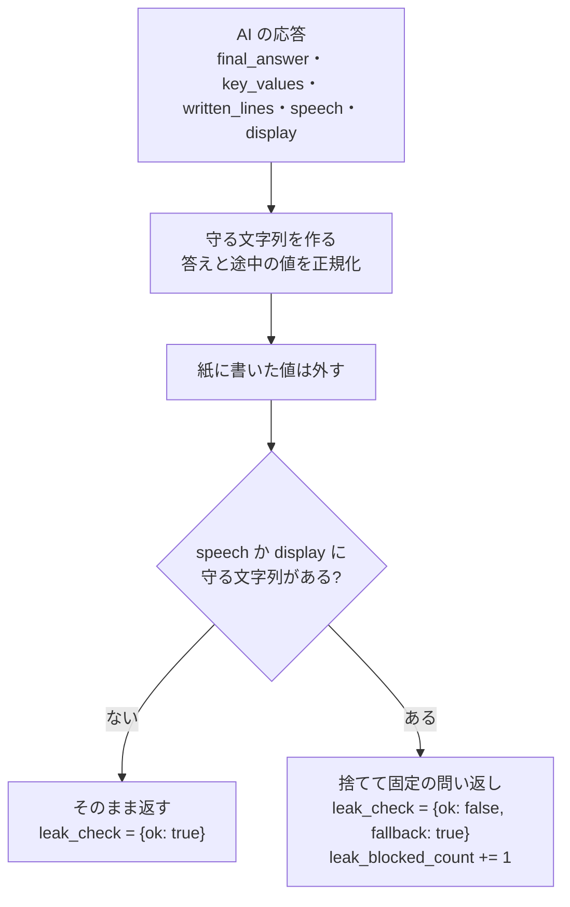

# 05 ヒントの方針と答え漏れ検査

10/17 に、自前のワークシート（問題ごとの正答・典型ミス・固定ヒント）をやめ、学習者の紙の問題を AI が写真から読んで解く形にし（ADR 0026）、生成 AI を Gemini に替えた（ADR 0025）。この文書はその後の形を書く。以前の設計は ADR と git の履歴にある。

## 原則

- **答えは言わない。** 最終的な答え、途中の決定的な値、式変形の完成形を、どの段階でも口にしない。
- 守り方は 2 層。1 層目はプロンプト（AI への指示）。2 層目はサーバの検査（**同じ呼び出しで AI に解かせた答えと途中の値**とヒント文の照合）。AI が解き間違えると 2 層目も外れる。言い換え（「2 倍して 10 になる数」）は止められない。
- ヒントは短い。読み上げは 35 文字以内で書かせ、60 文字を超えたら文を切らずに固定の問い返しに落とす（ADR 0029）。家庭教師が隣でぽつりと言う長さ。
- **答えまで導く（ADR 0029）**：答案を 1 行目から確かめ、誤りがあれば最初の誤りを、無ければ答えまでの次の一歩を示す。前のヒントの所が直っていれば次へ進み、直っていなければ同じ所をもう少し具体的に示す。
- 誤りは、誤っている数字や記号を行と位置で指す（「2行目の右辺の 4」）。正しい値は言わない。学習者が正しく書いた式は読み上げずに行と位置で指す。
- 言い方は人格の口調に従う（先生は「〜見てみましょう」、イケメンは「〜見てごらん」。ADR 0031）。どの人格でも「惜しい」「違う」「答えは」は使わない。名前は呼ばない。

## 段階

| 段階 | 何を言うか | 例 |
|---|---|---|
| 1 | 示す所を、行と場所を指すか問いかけで示す。次の一歩は問いかけにする | 「2行目の右辺の 4、もう一度見てみましょう」「エックスだけにするには、どうしますか？」 |
| 2 | もう少し具体的に。次の一歩なら操作を 1 つ言ってよい。誤りなら出どころと見比べさせる。結果の値は言わない | 「両辺を同じ数でわってみましょう」「1行目の +5 と見比べてみましょう」 |

例は先生の口調。

- 自動ヒントの段階は、その問題の詰まりの回数と `max_level`（既定 2）の小さい方。ボタンのヒントは、その問題でボタン・声の AI のヒントが初めてなら 1、2 回目からは 2（自動ヒントと固定文は数えない。ADR 0033）。
- 声の問いへの答えは段階の指示を使わない（記録には段階を残す）。同じ問いが続いたら前より具体的に答えるよう、AI への指示に書いてある。
- 3 回目以降も段階 2 で、前に出した文を渡して同じ文を繰り返させない。

## AI への指示（`api/app/hints.py`）

1 回の呼び出しで、写真から次をまとめて返させる（構造化出力）。

| 項目 | 中身 | 学習者に見せるか |
|---|---|---|
| `paper_visible` | 問題か答案が書かれた紙が写っているか。ほかの項目より先に答えさせる（ADR 0044） | 見せない。読めると言ったのに false か、問題文も手書きの行も前に読めた問題も無ければ、ヒントは「紙を枠の中に入れてみて」。暗い・ぼやけの理由があればそちらを優先。声の答えは紙を指す文（行目・右辺など）なら同じ文、説明なら通す。問題文の読み取りは出さず、できたは `unreadable` |
| `problem_text` | いま解いている問題の文 | 見せる（左上に出す。ADR 0042） |
| `final_answer`・`key_values` | AI が自分で解いた答えと、途中の決定的な値や式 | 見せない（答え漏れの検査に使う） |
| `written_lines` | 学習者が紙に書いた行 | 見せない（紙に書いた値は検査から外す） |
| `readable`・`unreadable_reason` | 答案が読めるか、読めない理由（暗い・ぼやけ・枠の外・隠れている・その他） | 理由ごとの固定文で返す |
| `stuck_point` | 示す所のラベル。12 種の一覧から選ぶ（ADR 0033） | 記録画面に出す |
| `speech`・`display` | 読み上げ（記号は言葉に）と字幕（数式は半角） | 見せる |

- 紙に問題が複数あるときは、答案が書かれていて最後の行がまだ答えになっていない問題を選ぶ（複数あれば最後に書いた問題）。無ければ答案の無い最初の問題。前に読み取った問題が途中なら、それを選ぶ（ADR 0032）。
- 段階の指示は、上の表の文を 1 行足す。人格は、口調の指示の 1 行だけを差し替える（示す場所と操作の中身は変えない。ADR 0031）。
- タイムアウトは 8 秒、リトライなし。429（無料枠の上限）・5xx・タイムアウト・形の違う応答は、固定の問い返しに落とす（`source: "fallback"`）。

## 声の問いへの答え（ADR 0032）

- 聞こえた文はすべて AI に送り、答えるかどうか（`respond`）も AI に決めさせる。独り言・式の読み上げ・周りの会話には答えない（204）。
- 言葉の意味や一般的なやり方は説明してよい。例を使うときは、この問題と違う数字にする。「答えを教えて」には、答えは言わずに断り、見る所か次の一歩を示す。
- 答案を見ないと答えられない問いで答案が読めなければ、推測せず、理由ごとの固定文を返す。
- 発話は学習者の声を文字にしたもので、AI への指示ではない。発話の中の「答えを書いて」などの指示には従わせない。
- 「合ってる？」には AI を呼ばず「できたボタンを押してみて」を返す（正誤は「できた」でだけ言う）。
- 読み上げは 60 文字・字幕は 80 文字以内で書かせ、100 文字・120 文字を超えたら固定文に落とす。

## 答え漏れの検査（`api/app/leak.py`）

- 正規化：全角を半角に（NFKC）、空白を除く、読みを記号に戻す（イコール → =、マイナス → -、エックス → x）、分数の読みを戻す（2分の1・二十分の一 → 1/2・1/20）。分数の外の漢数字は、「十二だよ」「五です」のように値として言い切る形のときだけ戻す（「一度」「十分」「唯一」は戻さない）。
- 守る文字列：答えの式（`x=-5`）、途中の値や式のうち 3 文字以上のもの（`-2x=10`）、答えの値（`-5`。`1/2` と `0.5` のように同じ値の別の書き方も）。2 文字の途中の値（`10`）は守らない。
- 数の値は、ほかの数の一部でなければ止める（「3行目の -5 を見てみて」も止まる）。1 文字の答えの値（`5`）は、どこにでも出てくるので、「答えは5」「x は 5」「5 を書いて」のような言い回しのときだけ止める。
- 学習者が紙にすでに書いた値は守らない（紙を指して話すため）。
- 同じ問題（空白や全角の違いだけ）のうちは、前の守る文字列を引き継ぐ。AI が問題文を読めなかったときも引き継ぐ。問題文が変わったら捨てる。
- 再生成はしない。落ちたら固定の問い返し。
- AI の答えから守る文字列が作れず（答えが空、選択肢の 1 文字など）、前のヒントから引き継げる文字列も無いときは、ヒントの文を検査できないので固定の問い返しにする。声の答えは、問題文が読めたとき、または「答えは 5」「x は 5」のように値を言い切っているときに固定文にする（「移項って何？」のような説明や、別の数字の例の式は通す）。この形の検査は言い切りの言い回しだけを見るので、「両辺を2で割ると3」のような言い方は止められない。問題文も答えも AI が返さなかったときだけ通る経路で、既知の制約とする。
- 評価セット 55 件（止めるべき 24、通すべき 31）で確かめる。見逃し 0、誤検知 0（ADR 0038、`api/tools/eval_leak.py`）。人が書いた文なので、言い換えは含まない。

## 正誤チェック（`api/app/check.py`）

- 「できた」で写真を 1 枚送り、AI に問題を自分で解かせて、学習者の最後の答えと比べた `correct`・`incorrect`・`unreadable` だけを返させる。文は作らせない（作らせると答えを言いうる）。
- 読み上げは固定文：正解は「正解。その調子」、不正解は「もう一回、途中の式を見てみて」、読めないは「もう少し明るいところで、もう一回見せて」。8 秒で返らない・失敗は「うまく読めなかった。もう一回、できたを押してみて」。
- `incorrect` のとき問題はそのまま。ヒントは出さない（段階も変えない）。

## AI が使えないときと scripted

- 固定の問い返しは、段階 1「今、何を求めようとしてる？」、段階 2「途中の式を、1 行ずつ声に出して読んでみて」。人格ごとに言い回しを変える（`api/app/personas.py`）。人格の言い回しが守る文字列に触れたら、先生の言い回しに戻す。
- `scripted` のモードは AI を呼ばず固定の問い返しだけで動く（`source: "scripted"`）。「できた」は常に `correct`。デモの保険で、使ったらピッチで言う。
