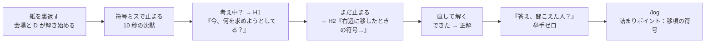

# 08 デモ台本

Hack Day 2 日目 16:00 のピッチ用。**持ち時間は 90 秒**（10/15 時点の運営情報。Day 1 20:10 に運営へ確認し、Day 2 15:30 の発表ガイダンスで再確認する）。Google Meet で画面を共有し、録画される。Award Day 進出はこの録画と README と動画を審査員がオンラインで見て決まり、会場の最優秀賞は会場投票で決まる。

山場は 1 つに絞る。**手が止まって、沈黙の後に声がかかり、答えを言わずに解ける。** 会場の全員に席の紙で同じ問題を解いてもらい、壇上と同時に詰まってもらう。最後に「答え、聞こえた人？」で会場を証人にする。

## 画面と機材の配置

- **ピッチでは PC のブラウザで `/device` を動かす**。Meet の録画に映るのがデバイス画面そのものである必要があるから。スマホ版は同じコードで、製品説明動画と展示会で見せる。
- iPhone をアーム式スタンドで紙の真上 40 cm に固定し、Mac の連係カメラとして PC につなぐ（USB Web カメラは買わない）。卓上ライトを紙の斜め上から。
- PC の画面を Meet で **「Chrome のタブを共有」**（ウィンドウ共有だと Mac では音が Meet に乗らない。タブ共有だけが音を運ぶ）。`/device` を開いたタブを共有し、全画面に。最後の 8 秒の `/log` は**同じタブ**でアドレスバーから `/log/<session_id>?k=<オペレータキー>` に移る（別タブに切り替えると共有が切れる。URL は準備中にメモに貼っておく）。
- 音：タブ共有のダイアログで **「タブの音声を共有」にチェック**（これが無いと Meet の録画は無音）。会場には会場のスピーカーに PC を 3.5 mm でつなぐ（つなげるかを 15:30 に確認し、駄目なら PC のスピーカーをマイクの前に置き、字幕で補う）。
- 操作する人（高橋）と解く人（D）は別にする。話す人は D。D は紙に向かって座り、カメラの下で解く。**ボタンは全部高橋が押し、ストップウォッチも高橋が持つ。** D は PC の画面を見ないので、合図は声 2 つだけ：高橋が「落とす」と言ったら D は `/log` を待たず締めの 1 文だけ、「飛ばす」と言ったら D は「判定は飛ばします。答えは言っていません」。何も聞こえなければ台本どおり。D が書き終えたら声で「できた」と言い、それを合図に高橋が 2 秒以内に押す（遅れると静止 10 秒で 3 回目の「考え中？」が鳴り、ボタンが効かなくなる）。
- **本番 iPhone は「自動ロック：なし」に設定する。** 手を止めて待つ間に画面が消えるとカメラも音声も止まる。サイレントスイッチも確認する。
- **デモ用セッションは `stuck_seconds: 10`、`cooldown_seconds: 0` で作る**（`/ops` か `uv run --directory api tools/create_session.py --stuck 10 --cooldown 0`）。1 回目の声は静止 10 秒で即（固定文）、2 回目の声は「H1 の読み上げ 3 秒＋静止 10 秒＋GPT 最大 8 秒」で 14〜21 秒後。ピッチで「今日は 10 秒に設定しています」と一言添える。時刻の予算は下の表（名目 1:28、最悪 1:38。1:20 までに「正解」が出ていなければ `/log` を落とす）。
- ピッチ中は `/device?…&debug=1` で開き、静止の秒数と動きスコアを画面の隅に小さく出す（学習者には見せない数字だが、録画を見る審査員には「検知している」証拠になる）。`/log` には `source: gpt` と `latency_ms` が大きく出る（C1-4）。デモの H2 は固定 H2 と同じ文なので、`source` を見せないと GPT が動いた証拠が録画に残らない。
- Meet は **別ウィンドウ**で開く（同じウィンドウの別タブにしない。バックグラウンドのタブはタイマーが遅れる）。Meet 自身の**カメラは OFF**（ON だと連係カメラを Meet が掴み、`/device` のカメラが取れない）。マイクは Day 2 午前の録音テストで決めた経路（タブ音声が録れていれば OFF、録れていなければ ON にして会場スピーカーの音を拾う）。
- カメラは Mac の Chrome で「iPhone カメラ」を選ぶ（`/device?cam=iphone`。`web/lib/camera.ts` がラベルに iPhone を含む入力を優先する）。

## 会場の紙

- WS-01 の問 2（`2x - 7 = 4x + 3`）だけを載せた A5 の紙を 100 部。表は白紙で裏に問題。「裏返してください」で始められる。
- 置く許可は **Day 1 の 20:10 のガイダンス後に運営へ直接聞く**（D。15:30 では Code Freeze 後で手が打てない）。駄目なら、D が冒頭の台詞で式を読み上げる：「2x ひく 7 イコール 4x たす 3。手元の紙かスマホのメモで解いてください」（映像の中の紙は会場からは読めない）。
- 紙の下部に「となり：手元だけを見ます。顔は映しません。映像は保存しません」を小さく入れる。

## 中間発表会（Day 1 19:10）での仕込み

- 動くものを見せる必要はない。「手が止まる → 声」の縦串が通っていれば 30 秒見せる。
- 会場に 2 つだけ頼む。「AI に宿題を聞いて、答えをそのまま写したことがある人？」で挙手。「明日、皆さんに中学 2 年の方程式を 1 問解いてもらいます」と予告。
- 中間発表の間に、会場の照明で動きスコアと τ を再計測する（高橋）。

## 準備（15:30〜15:55。順番を変えない）

1. テザリングでつながっていることを確認する（会場 Wi-Fi に頼らない）。Meet は別ウィンドウ、カメラ OFF。
2. `POST /demo/reset`。`scripted` のセッション（stuck 10・cooldown 0）を作り、`/device?s=…&t=…&cam=iphone&debug=1` を Mac の Chrome で開いて 1 回通す：はじめる → 「見守りを始めるよ」が会場スピーカーで鳴る → 次へ（問 1 を飛ばす）→ 手を止めて 10 秒 → H1 → また 10 秒 → H2 → できた → 正解。画角に紙全体が入り手を置いても顔が入らないこと、手を止めると `debug` の動きスコアが τ を下回ることをここで見る。
3. もう一度 `POST /demo/reset`。`live` のセッション（stuck 10・cooldown 0、WS-01）を作り、同じタブで `/device?s=…&t=…&cam=iphone&debug=1` を開く。**「はじめる」は押さない**（押すと順番待ちの間に鳴り続け、`stuck_count` が増えて本番の 1 回目が H2 になる）。`/log/<id>?k=…` の URL をメモに貼る。
4. そのタブを Meet で「Chrome のタブを共有」し、「タブの音声を共有」にチェック。会場の投影に出るなら全画面（`⌃⌘F`）にしてアドレスバーの `t=` を隠す。
5. 録画動画（L4）をすぐ再生できる場所に置く。新しい WS-01 の紙、鉛筆、消しゴム。
6. 自分たちの番が来たら：「はじめる」→ 1 秒後に「次へ」（問 1 を飛ばす）→ D が話し始める。「見守りを始めるよ」は D の最初の台詞に重なってよい。

## 90 秒の台本

| 時間（名目） | 会場がすること | 画面と音 | D が話す |
|---|---|---|---|
| 0:00〜0:08 | 席の紙を裏返す | 高橋が「はじめる」→ 1 秒後「次へ」。「見守りを始めるよ」。状態「見守り中」 | 「席の紙を裏返して、一緒に解いてください。となりは黙っています」 |
| 0:08〜0:18 | 解き始め、多くが符号で止まる | D が `2x − 4x = 3 − 7` と書き、**ペンを置いて手を紙の外に出す** | 書きながら「ここで止まったとします。これから出る言葉に答えが入っているか、数えていてください」 |
| 0:18〜0:28 | 沈黙 10 秒を共有 | バッジと `debug` の秒数だけ。高橋はバッジを指す | 何も言わない |
| 0:28〜0:32 | | 「考え中？」→ 固定文の声と字幕「今、何を求めようとしてる？」（読み上げ 3 秒） | |
| 0:32〜0:45 | 「あ、符号」が会場で起きる | D「x の値を…」と 3 秒だけ答案を見て、また手を紙の外へ。10 秒で「考え中？」 | 黙る |
| 0:45〜0:53 | | GPT の H2（1〜8 秒）「右辺に移したときの符号、もう一回見てみて」（返らなければ固定文の H2）。読み上げ 4〜7 秒 | 読み上げが終わったら「答えの数字は、出ていません」 |
| 0:53〜1:08 | | D が `2x − 4x = 3 + 7`、`−2x = 10`、`x = −5` と直す（読み上げ中に書き始めてよい）。書き終えたら D が声で「できた」→ 高橋が 2 秒以内に「できた」を押す → D はペンを置く | 「できた」 |
| 1:08〜1:18 | 挙手「答え、聞こえた人？」→ ゼロ | 「見てるよ…」（判定 2〜8 秒）→「正解。符号の直し方、ばっちり」 | 判定を待つ間に「答え、聞こえた人？ ……ゼロ。皆さんが証人です」 |
| 1:18〜1:28 | | 同じタブで `/log/<id>?k=…` へ。2 問目：詰まり 2 回、H2、`source: gpt`、詰まりポイント「移項の符号」。映像なし | 「残るのは映像でなく、このラベルだけ。答えを教える AI は、もうある。となりは、答えを言わない」 |

名目 1:28。GPT が 2 回とも 8 秒かかると 1:38 なので、**1:20 の時点で「正解」が出ていなければ `/log` を落とし、締めの 1 文（6 秒）だけ言う**（最悪 1:32）。「できた」の押し直しはしない（`unreadable` なら「次へ」を押して締めに入る）。D0-2 は今夜タイマーで、D2-1 は本番の設定で**実機で計時**する。

言わないこと：仕組みの説明、競合、スポンサーへの言及。90 秒では体験だけを残し、仕組みと実現可能性は README と製品説明動画に書く。

## 時間が押したとき

- 1:20 に「正解」が出ていなければ `/log` を落とし、締めの 1 文だけ言う。
- 2 回目の静止（H2）が来なければ、高橋が「ヒント」ボタンを押して H1 をもう一度出し、D は自力で直す。「符号」の文は出ないが、答えを言わないことは示せる。
- 沈黙は削らない。ここが「気づく」の証明。

## 失敗したとき

| 症状 | 対応 |
|---|---|
| 10 秒たっても「考え中？」にならない | `?debug=1` で動きスコアを見る。τ より上なら D が手を紙から離して完全に止める。それでも駄目なら「ヒント」ボタン（手動）で続ける |
| 「考え中？」の後、ヒントが来ない（GPT 遅延） | 8 秒待つ。来なければ固定ヒントが自動で出る（`source: fallback`）。GPT の H2 と同じ文なので D には区別できない。何も言わず、`/log` の `source` に語らせる |
| 「できた」の後「見てるよ…」が 8 秒続く | GPT の正誤が返らず `unreadable` になる。押し直さず「次へ」を押し、D が「判定は飛ばします。答えは言っていません」と言って締めに入る |
| H1 の後、D が動いて 10 秒の静止が取れない | D はペンを置いて手を紙の外に出す。`stuck` 中の動きは無視されるので、一度「考え中？」になれば動いてもヒントは出る |
| 順番待ちの間に となり が鳴る | 「はじめる」を押してしまっている。`/demo/reset` → `live` で作り直し → 同じタブで開き直す（タブ共有は切れない） |
| Meet の録画に声が乗っていない（Day 2 午前の録音テストで判明） | Mac の 3.5 mm → 会場スピーカー → Meet のマイク ON の経路に切り替える。字幕は常に出ているので録画で読める |
| ヒントが答案と関係ない文 | そのまま続ける。H1 は問い返しなので違和感が小さい |
| 音が出ない | 字幕で続ける。「音は字幕と同じです」と言う。スピーカーの再接続は試みない |
| カメラが止まった | ブラウザを再読み込みし「はじめる」からやり直す。30 秒で戻らなければ `scripted` でセッションを作り直す（L2） |
| API が落ちた | `RUNBOOK.md` の手順で再起動。戻らなければローカル（L3） |
| 紙を置けなかった（Day 1 20:10 に分かる） | D が冒頭の台詞に式を声で足す：「2x ひく 7 イコール 4x たす 3。手元の紙かスマホのメモで解いてください」（+4 秒）。画面に問題を出す機能は作らない |
| 全部駄目 | 録画動画（L4）を再生し、「録画です」と言う |

## 製品説明動画（Day 2 12:00〜14:00 に撮る）

オンライン審査の審査員が見る動画。90 秒の録画では落とした仕組みと実現可能性をここで補う。4 分以内。

| 時間 | 内容 |
|---|---|
| 0:00〜0:30 | 問題：AI に聞くために手が止まり、聞けば答えが出てくる。家庭教師は隣で気づいて、答えを言わない |
| 0:30〜1:00 | 開始。スマホとスタンドだけ。1 問目を解く間は黙っている。「できた」→ 正解 |
| 1:00〜2:30 | 2 問目で止まる → 20 秒 → H1 → H2 → 直して正解。「答えの数字は一度も言っていない」 |
| 2:30〜2:55 | 3 問目で「わからない」と言う（声のトリガー。入らなければ「ヒント」ボタン）。`/log` の「答えを言いそうになって止めた回数」。サーバの文字列検査の説明 |
| 2:55〜3:25 | `/log`。映像でなく詰まりポイント。保護者が見るもの |
| 3:25〜4:00 | 仕組み 3 点（気づく・答えを言わない・ラベルを残す）と既知の制約 |

- PC 版で撮る。1 分版（スマホ版、場面 3 だけ）を別に撮り、README の先頭に GIF で置く。
- 音声は D のナレーションを後から当ててよい。となりの声は実際の読み上げを残す。
