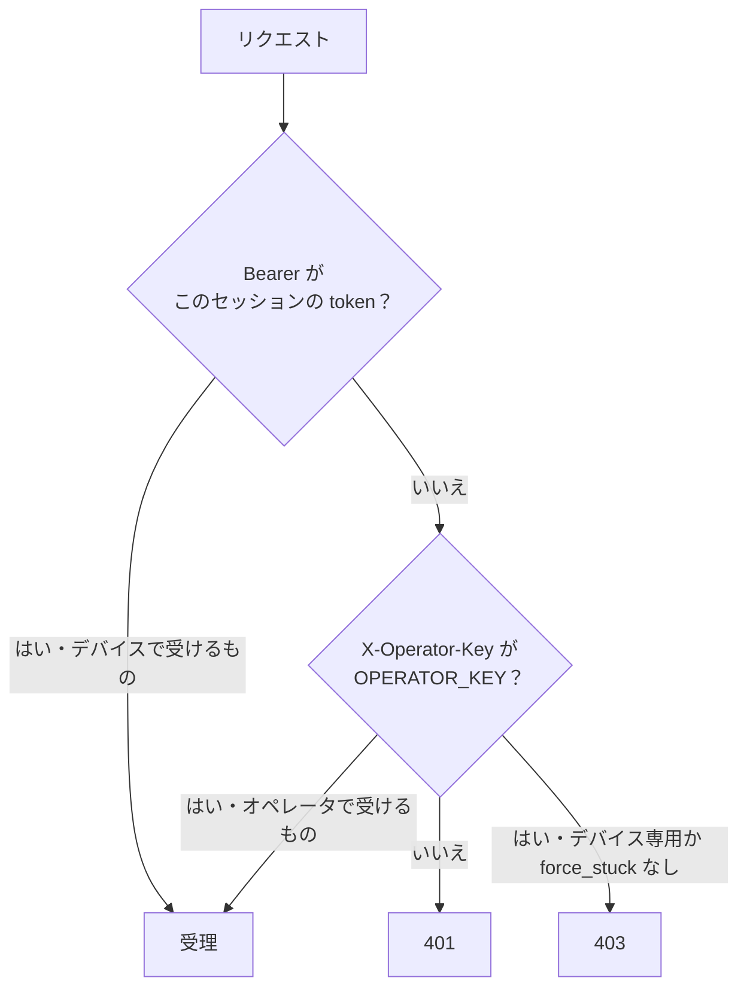

# 0007. 鍵が無いか不一致なら 401、系統違いなら 403 を返す

- ステータス: 承認
- 日付: 2026-10-17

## 文脈

`docs/03` の「共通事項」は使う HTTP ステータスに 401 と 403 を挙げているが、使い分けは書いていない。`docs/02` の「認可の 3 系統」は、デバイス（Bearer の session_token）とオペレータ（`X-Operator-Key`）で使えるエンドポイントを分け、signals だけは `force_stuck: true` のときオペレータでも通すと決めている。

## 検討した選択肢

1. 鍵が無いか一致しなければ 401、鍵は正しいが系統が違えば 403
2. 認可の失敗はすべて 401 で、403 は使わない

## 決定

選択肢 1。403 になるのは次の 2 つ。

- デバイス専用のエンドポイント（settings・frames・hints・check・advance）に、正しい `X-Operator-Key` で来た
- `force_stuck` の無い signals に、正しい `X-Operator-Key` で来た

## 理由

- 02 の表の境界がそのまま応答に出るので、B の `/ops` で「鍵を間違えた」のか「その操作はオペレータではできない」のかが分かる
- 03 の一覧と食い違わない

## 受け入れたトレードオフ

- routes の認可に分岐が 1 つ増える

## 再検討する条件

- 系統が増えたとき（例えば保護者用の閲覧鍵）
